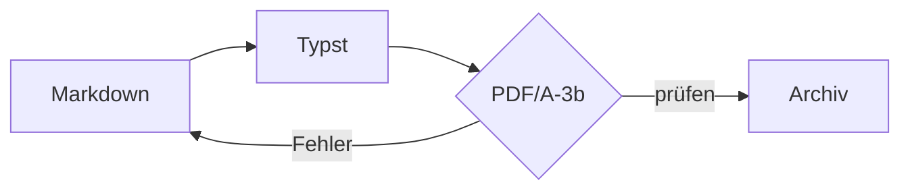
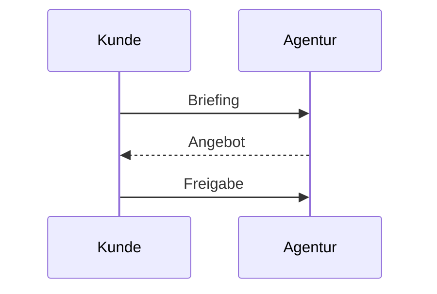

Dieses Dokument ist zugleich **Vorlage**, **Schaustück** und **Falltest**: Es ist mit genau der
Pipeline gesetzt, die es beschreibt, und zeigt jede Funktion in ihren Varianten.[^pipeline]
Die Markdown-Quelle liegt als Anhang im PDF und lässt sich jederzeit wieder herauslösen.[^attach]

[^pipeline]: Markdown → Typst (Packages *cmarker*, *mitex*, *mmdr*) → PDF/A-3b, vollständig offline.

[^attach]: Zum Beispiel mit `mutool extract datei.pdf`.

# Kopf, Titel und Fuß

Der **Titelblock** oben entsteht aus dem Frontmatter: `toptitle` (klein, gesperrt), `title`,
`subtitle` und die Zeile „Datum · Autor“ aus `date` und `author`. Die **Kopfzeile** zeigt ab
Seite 1 das aktuelle Kapitel, rechts das Logo aus `logo:` (höchstens 13 × 60 mm). Die **Fußzeile** zeigt
links „Toptitel · Titel“ (weil `toptitle` gesetzt ist), in der Mitte die Seitenzahl und rechts das
Datum. Das **Wasserzeichen** „BEISPIEL“ liegt unter allem.

Varianten, die dieses Dokument nicht zeigt:

- `header: "Vertraulich"` ersetzt das laufende Kapitel durch festen Text.
- Ohne `toptitle` und `subtitle` steht links unten der Dateiname; `print_filename: false` blendet
  ihn aus.
- `lang: en` stellt Datum, Beschriftungen und Anführungszeichen auf Englisch um.
- Ohne `logo:` bleibt der Kopf ohne Logo. `logo: kunde.png` sucht die Datei neben der Notiz,
  dann im Benutzerordner, dann im Installordner.

Alle Schlüssel mit ==Standardwerten== stehen in `header.md`.

# Text & Typografie

## Auszeichnung

Im Fließtext funktionieren *kursiv*, **fett**, ***beides***, `Inline-Code`, ~~durchgestrichen~~,
==markiert== und [Verweise](https://typst.app). Längere Absätze stehen im **Blocksatz mit
Silbentrennung**; im Text erscheinen Mediävalziffern (1, 2, 3 … 2026), in Tabellen Versalziffern.

## Anführungszeichen, Striche, Auslassungen

| Getippt | Ergebnis |
|---------|----------|
| `"gerade"` und `'einfach'` | "gerade" und 'einfach' |
| `das geht's` | das geht's |
| `„deutsch“ »französisch« “englisch”` | „deutsch“ »französisch« “englisch” |
| `Seite 3--5` (Bis-Strich) | Seite 3--5 |
| `9--17 Uhr` (Bis-Strich) | 9--17 Uhr |
| `Pause -- dann weiter` (Gedankenstrich) | Pause -- dann weiter |
| `Gedanke---Strich` (Geviertstrich) | Gedanke---Strich |
| `Moment...` (Auslassungszeichen) | Moment... |

Gerade Anführungszeichen werden nach Sprache gesetzt, getippte typografische bleiben exakt
erhalten. Code bleibt unberührt: `echo "x" --flag ...`.

## Geschützte Leerzeichen

Zwischen Abkürzungen wie z. B., d. h. oder u. a. und zwischen Zahl und Einheit — 12 pt, 5 %,
1.234,56 €, 300 dpi, 20 °C — bricht keine Zeile um.

## Zeilenumbrüche

Standard ist: Jede Zeile bleibt eine Zeile, wie im Editor getippt — praktisch für Mitschriften.
Dieses Dokument ist im Quelltext umbrochen und setzt deshalb `hard_breaks: false`: Ein
einzelner Zeilenumbruch in der Quelle wird dann zum Leerzeichen (CommonMark).

Einen Umbruch erzwingen auch dann  
zwei Leerzeichen am Zeilenende\
oder ein Backslash.

## Datumszeilen

18. Oktober 2026
19. Okt. 2026

Zeilen, die mit Zahl, Punkt und Monatsnamen beginnen, bleiben Datumsangaben und werden nicht
zur nummerierten Liste.

# Überschriften

Die Ebenen haben feste Rollen: Der **Titel** kommt aus `title:`, `#` ist ein **Kapitel** (feine
Linie, Kopfzeile, neue Seite bei `h1_break`), darunter folgen Unterabschnitte.

## Zweite Ebene

Serif, ohne Linie.

### Dritte Ebene

In Fließtextgröße, fein unterstrichen.

#### Vierte Ebene

In Fließtextgröße, kursiv; tiefere Ebenen ebenso.

##### Fünfte Ebene

Wie die vierte.

# Listen

## Aufzählungen

- Erste Ebene mit kleinem Quadrat
  - Zweite Ebene, gleicher Marker
    - Dritte Ebene, gleicher Marker
- Zurück auf der ersten Ebene

## Nummeriert und verschachtelt

1. Quelle in Markdown schreiben.
2. Frontmatter ergänzen:
   1. `title` und `date`,
   2. bei Bedarf `toc` und `h1_break`.
3. Bauen lassen — fertig.

Eine Liste darf mit beliebiger Zahl beginnen:

7. Siebter Punkt
8. Achter Punkt

## Gemischte Liste

Normale Punkte und Aufgaben dürfen sich mischen; das Kästchen steht bündig mit den Punkten:

- Ergebnis des Workshops
- [x] Farbwelt festgelegt
- [ ] Schriftwahl offen – Anna Beispiel, bis 09.11.
- Nächster Termin folgt

# Aufgaben

Eine Liste, die **nur** aus Aufgaben besteht, wird zur Tabelle. Wer und bis wann stehen hinter
einem Gedankenstrich: `- [ ] Aufgabe – Name, bis Datum`.

## Mit Wer und Bis

- [x] Konzept festlegen – Anna Beispiel, bis 30.09.
- [x] Pipeline umsetzen – Ben Probe, bis 07.10.
- [ ] Feinschliff am Layout – Anna Beispiel, bis KW 44
- [ ] Bildrechte klären – Kundin, bis Freitag

## Nur Wer

- [ ] Logo liefern – Kundin
- [x] Farbwerte prüfen – Ben Probe

## Nur Bis

- [ ] Sitemap abstimmen – bis 24.10.
- [ ] Texte freigeben – bis 31.10.

## Checkliste

- [ ] Impressum aktualisieren
- [x] Datenschutzerklärung prüfen
- [ ] Favicon austauschen

# Hinweisboxen

GitHub-Schlüsselwörter:

> [!NOTE]
> Ergänzende Information.

> [!TIP]
> Ein hilfreicher Tipp.

> [!IMPORTANT]
> Etwas, das nicht übersehen werden darf.

> [!WARNING]
> Ruhiges Orange statt Warnrot.

> [!CAUTION]
> Folgen bedenken.

Deutsche Schlüsselwörter, auch mit Text in derselben Zeile und mehreren Absätzen:

> [!HINWEIS] Text darf direkt hinter dem Schlüsselwort beginnen.
>
> Ein zweiter Absatz mit **Auszeichnung** und einer Liste:
>
> - erster Punkt
> - zweiter Punkt

> [!INFO]
> Gleichwertig zu `[!NOTE]`; ebenso `[!TIPP]`, `[!WICHTIG]` und `[!ACHTUNG]`.

Ein Zitat ohne Schlüsselwort bleibt ein eingerücktes, kursives Zitat:

> Inhalt gehört in reinen Text, die Form ins Template.

# Tabellen

## Angebot mit Summe

Zahlen- und Betragsspalten stehen automatisch rechtsbündig, die Spalten so breit wie ihr Inhalt:

| Pos. | Leistung | Menge | Einzelpreis | Gesamt |
| ---- | -------- | ----- | ----------- | ------ |
| 1 | Konzeption und Workshop | 8 Std. | 120,00 € | 960,00 € |
| 2 | Gestaltung aller Seiten | 12 Std. | 110,00 € | 1.320,00 € |
| 3 | Lizenz Bildmaterial | 1 | 89,90 € | 89,90 € |
| | **Summe netto** | | | **2.369,90 €** |

## Ausrichtung aus der Trennzeile

| links | zentriert | rechts | ohne Angabe |
| :---- | :-------: | -----: | ----------- |
| A | B | C | Text bleibt links |
| längerer Text | mittig | 99,5 % | 1.234 |

## Textreiche Spalten

| ID | Anforderung | Priorität |
| -- | ----------- | :-------: |
| A-01 | Die Startseite zeigt die drei wichtigsten Leistungen mit je einem Bild und einem kurzen Text, ohne dass gescrollt werden muss. | hoch |
| A-02 | Ein Newsletter-Anmeldefeld im Fuß. | mittel |

## Auszeichnung und Symbole in Zellen

| Element | Schrift | Beispiel | Status |
| ------- | ------- | -------- | :----: |
| Fließtext | Source Sans 3 | **fett**, *kursiv* | ✓ |
| Überschriften | Source Serif 4 | „Kapitel“ | ✓ |
| Code | Source Code Pro | `print("hi")` | ⚠ |

Weitere Tabellenformen — Quartalszahlen, zwölf Monatsspalten, lange Tabellen über mehrere
Seiten — zeigt `tests/fixtures/tables-showcase.md`.

# Abbildungen

Ein lokales Bild mit Alt-Text wird zur nummerierten Abbildung mit Unterschrift:


Mit `{width=…}` lässt sich die Breite setzen, hier 50 %:

{width=50%}

Ohne Alt-Text erscheint nur das Bild, hier 6 cm breit:

{width=6cm}

Ein **fehlendes Bild** bricht den Export nicht ab, sondern hinterlässt einen Hinweis (der Build
meldet es zusätzlich als Warnung):


**Remote-Bilder** lassen sich offline nicht laden und entfallen; der Build meldet ihre Zahl:


# Diagramme

Mermaid-Diagramme werden offline gezeichnet. Ein Ablauf:



Ein Ablauf zwischen Beteiligten:



# Formeln

Formeln stehen im Text wie $E = mc^2$ oder $a^2 + b^2 = c^2$ oder abgesetzt:

$$
\int_{a}^{b} f(x)\,\mathrm{d}x = F(b) - F(a)
$$

$$
\sum_{i=1}^{n} i = \frac{n\,(n+1)}{2}
$$

# Code

Codeblöcke erhalten Syntax-Hervorhebung:

```python
from pathlib import Path

def render(src: Path) -> Path:
    """Markdown -> PDF/A; gibt den Ausgabepfad zurück."""
    return src.with_suffix(".pdf")
```

```bash
markdown-office --no-source --hard-breaks notiz.md ziel.pdf
```

```json
{ "title": "Beispiel", "lang": "de", "toc": true }
```

# Definitionslisten

PDF/A-3b
: Archivformat mit erlaubten Dateianhängen — hier die Markdown-Quelle. Erlaubt Auszeichnung wie
  `code` in der Beschreibung.

Variable Schrift
: Eine Schriftdatei, die über eine Achse (`wght`) beliebige Strichstärken liefert.

# Sonderzeichen & Emoji

Normaler Text bleibt **Source Sans 3**; nur Zeichen, die Source nicht kennt, kommen einzeln aus
**Noto Emoji** und **Noto Sans Symbols 2** — einfarbig und PDF/A-tauglich:

- Objekte und Status: 🚀 📊 📝 🔑 🔍 📌 ☑ ✗ ⚠ 💡 ◎ 🔒.
- Gesten und Natur: ☺ 👍 👎 👀 🥽 ✿ ⚡ ❄ ☾ ☆ 🔥 🌱.
- Pfeile: → ← ↑ ↓ ⇒ ⇐ ⇔ ➤.
- Häkchen und Marker: ✓ ✔ ✗ ✘ ☑ ☐ ★ ☆ • ▪ ▸.
- Mathe und Technik: ± × ÷ ≤ ≥ ≠ ≈ ∞ √ ∫ ∑ ∂ ∈ ⊆ ½ m² H₂O CO₂.
- Währung und Recht: € £ ¥ $ ₿ № § ¶ © ® ™ ‰.
- Geometrie und Spiel: ■ □ ▲ △ ● ○ ♦ ◇ ♠ ♥ ♣ ♛ ♞.

# Seitenumbruch

Ein Seitenumbruch lässt sich mit `<!-- pagebreak -->` oder `\newpage` auf einer eigenen Zeile
erzwingen. Nach dieser Zeile folgt eine neue Seite.

<!-- pagebreak -->

Damit ist der Rundgang abgeschlossen: eine Markdown-Quelle, ein archivfähiges PDF, die Quelle
inklusive.

---

*Zum Nachschlagen:* alle Einstellungen in `header.md`, alle Tabellenformen in
`tests/fixtures/tables-showcase.md`, die vollständige Beschreibung in der README.
